# 🚀 Awesome Recruitment Automation

<p align="center">
  
</p>

<p align="center">
  <a href="https://github.com/ishandutta2007/Awesome-Awesome-Awesome"></a><a href="https://discord.gg/jc4xtF58Ve"></a>
  <a href="https://github.com/ishandutta2007/Awesome-Recruitment-Automation/stargazers"></a>
  <a href="https://github.com/ishandutta2007/Awesome-Recruitment-Automation/network/members"></a>
  <a href="https://github.com/ishandutta2007/Awesome-Recruitment-Automation/issues"></a>
  <a href="LICENSE"></a>
  <a href="https://github.cmm/ishandutta2007"></a>
</p>

---

> **A curated directory of category-defining Recruitment Automation SaaS platforms, AI Sourcing assistants, Talent Intelligence engines, and battle-tested open-source Applicant Tracking Systems (ATS).**

*Empowering Talent Acquisition (TA) leaders, Recruiting Operations specialists, Headhunters, and HR Engineers to automate candidate discovery, semantic resume screening, structured interview scheduling, and end-to-end hiring pipelines.*

---

## 📑 Table of Contents

- [🌐 Sector Overview & Market Dynamics](#-sector-overview--market-dynamics)
- [🏢 SaaS & Hosted Recruitment Automation Platforms](#-saas--hosted-recruitment-automation-platforms)
- [💻 Open-Source GitHub Projects (Ranked by Stars)](#-open-source-github-projects-ranked-by-stars)
- [📐 Recruitment Automation Architecture & Pipeline Workflow](#-recruitment-automation-architecture--pipeline-workflow)
- [🔍 SEO & Industry Taxonomy](#-seo--industry-taxonomy)
- [🤝 How to Contribute](#-how-to-contribute)
- [⚠️ Compliance, AI Ethics & Data Privacy](#-compliance-ai-ethics--data-privacy)
- [⭐ Star History](#-star-history)
- [💖 Support & Community](#-support--community)

---

## 🌐 Sector Overview & Market Dynamics

The global **Recruitment Automation and AI-Driven Talent Acquisition Market** is estimated at **$2.6 Billion to $3.8 Billion in 2025–2026** and is projected to expand to **$8.2 Billion to $10.5 Billion by 2032**, advancing at a Compound Annual Growth Rate (**CAGR of ~8.5% to 11.2%**), accelerated by the rapid shift toward agentic candidate sourcing, automated skill graph inference, and conversational voice/chat pre-screening.

The industry exhibits a **hybrid structure: moderately concentrated in the large enterprise core**, where global Human Capital Management (HCM) conglomerates (*Workday, Oracle, SAP SuccessFactors*) and late-stage talent intelligence platforms (*Eightfold.ai, Phenom*) command enterprise-wide system-of-record contracts, but **highly fragmented across mid-market point solutions and emerging open-source engines**, where specialized AI tooling (*Gem, SeekOut, HireEZ, Sense*) and community codebases compete aggressively across conversational recruitment bots, automated calendar orchestration, and vector-based semantic resume matching.

---

## 🏢 SaaS & Hosted Recruitment Automation Platforms

*The following table catalogs category-defining commercial Recruitment Automation and Talent Intelligence platforms. The table is strictly sorted descending by company scale (market capitalization or private valuation).*

| 🏢 Platform / Vendor | 💰 Company Valuation / Revenue | 🏷️ Specific Starting Pricing | 🎁 Specific Free Tier / Trial Limits | ⚡ Core Recruitment Automation Capabilities |
| :--- | :--- | :--- | :--- | :--- |
| **[Workday Connected Recruiting](https://www.workday.com/)** | **~$55 Billion Market Cap** (NASDAQ: `WDAY`; ~$10.0B Annual Revenue) | **~$34.00 – $42.00 / employee / month** (PEPM core HCM base; enterprise recruiting bundles typically require **$150,000+/year** minimum annual contract commitment) | **No self-serve free trial** (0 days); guided enterprise sandbox proof-of-concept environment and 1-on-1 walkthrough upon sales qualification. | Unified enterprise talent acquisition within Workday HCM; AI-assisted candidate matching, automated interview scheduling, HiredScore predictive talent intelligence, and connected workforce planning. |
| **[Eightfold.ai](https://eightfold.ai/)** | **~$2.1 Billion Valuation** (Series E unicorn; ~$100M+ ARR) | **~$7.00 – $10.00 / employee / month** (billed annually; minimum contract sizes typically start at **$80,000 – $100,000+/year**) | **No self-serve free trial** (0 days); custom enterprise proof-of-concept (PoC) sandbox demo and skills inference dataset pilot upon request. | Deep-learning Talent Intelligence Platform with global neural network talent models, autonomous agentic interviewing, explainable skill matching, and internal talent mobility. |
| **[Phenom](https://www.phenom.com/)** | **~$1.4 Billion Valuation** (Late-stage venture-backed; ~$120M+ ARR) | **~$7.00 – $13.00 / employee / month** (median contract ~$98,000/year on Vendr; baseline annual contracts start from **$37,500/year**) | **No self-serve free trial** (0 days); customized live product demonstration and interactive candidate experience demo environment by request. | End-to-end Talent Experience Platform (TXP) with hyper-personalized career sites, automated recruitment marketing drip sequences, conversational bots, and calendar scheduling. |
| **[SeekOut](https://seekout.com/)** | **~$1.2 Billion Valuation** (Series C unicorn; ~$50M+ ARR) | **$149.00 / month** (billed annually at $1,788/yr) or $179/mo for Recruit Core tier (up to 3 user seats, 500 contact credits/month) | **14-Day Free Trial** on Recruit Core (full candidate search across 1B+ talent profiles, test contact credits, no credit card required). | AI-driven outbound talent search across 1B+ profiles; GitHub/patent deep search, diversity sourcing analytics, candidate rediscovery, and automated ATS silver-medalist matching. |
| **[Gem](https://www.gem.com/)** | **~$1.2 Billion Valuation** (Series C unicorn; ~$60M+ ARR) | **~$130.00 / month** (billed annually for startup tier, 1–10 FTEs); mid-market & enterprise plans median ~$25,000/year (**$7,000 – $73,000+/year**) | **14-Day Free Trial** (Chrome sourcing extension for LinkedIn, automated email outreach drip campaigns, up to 50 candidate email lookups). | Modern talent CRM, automated multi-channel candidate outreach sequences, pipeline forecasting analytics, executive search tracking, and all-in-one ATS. |
| **[Paradox (Olivia)](https://www.paradox.ai/)** | **~$1.0 Billion – $1.1 Billion Valuation** (Acquired by Workday in 2025; ~$120M Revenue) | **~$1,000.00 / month** ($12,000/year entry baseline; high-volume enterprise rollouts typically median **$30,000 – $100,000+/year**) | **No self-serve free trial** (0 days); live interactive SMS/web conversational bot demo and structured enterprise pilot program by sales request. | Conversational AI recruiting assistant (Olivia) automating 24/7 mobile SMS/WhatsApp candidate screening, instant interview calendar booking, and high-volume hourly hiring workflows. |
| **[Beamery](https://beamery.com/)** | **~$1.0 Billion Valuation** (Series D unicorn; ~$60M+ ARR) | **~$5,000.00 / month** (~$60,000 – $76,000/year median contract on Vendr; enterprise multi-module deployments start at **$100,000+/year**) | **No self-serve free trial** (0 days); guided 30-day enterprise proof-of-concept and customized sandbox evaluation for qualified enterprise teams. | Talent lifecycle management suite, enterprise CRM, AI skills-based talent intelligence, internal mobility matching, and compliance-first talent rediscovery. |
| **[Sense (SenseHQ)](https://www.sensehq.com/)** | **~$500 Million Valuation** (Series D; SoftBank Vision Fund 2; ~$40M+ ARR) | **$500.00 / month** ($6,000/year for standalone SMS/scheduling); complete Sense AI Recruiter platform starts at **~$2,000 – $3,000/month** (~$24,000 – $36,000/year) | **No self-serve free trial** (0 days); customized product demonstration and 14-day guided proof-of-concept pilot for qualified staffing and talent teams. | AI talent engagement and recruitment communication automation, two-way SMS/WhatsApp campaigns, conversational chatbot screening, and automated calendar sync. |
| **[HireEZ](https://hireez.com/)** | **~$180 Million Valuation** (Series B; $44M funding; ~$25M+ ARR) | **$494.00 / month** (Solo Recruiter plan billed monthly, or $395/month billed annually; enterprise team packages median **~$13,000/year**) | **7-Day Free Trial** on Solo Recruiter tier (open candidate discovery across 800M+ profiles, 10 candidate contact enrichment credits, Chrome extension access). | Outbound AI talent sourcing, automated contact enrichment (email/phone), multi-touch email sequences, and centralized candidate pipeline management. |
| **[Fetcher](https://fetcher.ai/)** | **~$35 Million Funding** (Acquired by Juicebox in October 2026) | **$115.00 / month** (billed annually at $1,380/year for starter self-serve tier; Growth tier from **$379 – $499/month**) | **14-Day Guided Trial** (sourcing test with up to 25 verified candidate profiles across 1 active job req; transitioned to Juicebox). | Automated outbound sourcing engine combining machine-learning discovery with personalized email outreach campaigns and automated follow-ups. |

---

## 💻 Open-Source GitHub Projects (Ranked by Stars)

*The following open-source recruitment systems, applicant tracking engines, and resume parsers are strictly ranked descending by their GitHub stargazers count.*

1. **[Resume Matcher](https://github.com/srbhr/Resume-Matcher)** [](https://github.com/srbhr/Resume-Matcher/stargazers)  
   *The #1 open-source AI harness for parsing resumes, extracting structured candidate data, and scoring applicant fit against job descriptions locally with 100+ LLMs support; supports semantic vector search and ATS keyword benchmarking.*

2. **[Frappe HR](https://github.com/frappe/hrms)** [](https://github.com/frappe/hrms/stargazers)  
   *Comprehensive open-source HR and payroll suite (GPL-3.0) with a dedicated recruitment module featuring job openings, applicant tracking pipelines, automated candidate interview scheduling, and employee onboarding.*

3. **[Ever Gauzy](https://github.com/ever-co/ever-gauzy)** [](https://github.com/ever-co/ever-gauzy/stargazers)  
   *Full-scale open-source business management platform (AGPL-3.0) incorporating an integrated ATS and candidate CRM module; supports candidate stage progression, recruiter task management, and talent pipeline tracking.*

4. **[Horilla](https://github.com/horilla/horilla-hr)** [](https://github.com/horilla/horilla-hr/stargazers)  
   *Modern open-source HRMS (LGPL-2.1) built with Django and PostgreSQL; includes a dedicated recruitment engine with drag-and-drop kanban candidate stages, job posting boards, interview rounds, and candidate evaluation forms.*

5. **[OrangeHRM](https://github.com/orangehrm/orangehrm)** [](https://github.com/orangehrm/orangehrm/stargazers)  
   *Widely deployed open-source Human Resource Management system (GPL-3.0) with an integrated recruitment and applicant management subsystem for job vacancy tracking, applicant screening, and interview scheduling.*

6. **[OpenCATS](https://github.com/opencats/OpenCATS)** [](https://github.com/opencats/OpenCATS/stargazers)  
   *The longest-standing open-source Applicant Tracking System (MPL-2.0) engineered specifically for recruitment agencies and corporate HR teams; features resume parsing, pipeline management, and career portal integration.*

7. **[Nueno](https://github.com/nueno-co/nueno)** [](https://github.com/nueno-co/nueno/stargazers)  
   *Modern open-source Applicant Tracking System designed for startups and fast-moving teams with clean candidate pipeline management, interview notes, and candidate collaboration.*

8. **[Smart AI Resume Analyzer](https://github.com/Hunterdii/Smart-AI-Resume-Analyzer)** [](https://github.com/Hunterdii/Smart-AI-Resume-Analyzer/stargazers)  
   *AI-driven resume parsing and candidate evaluation engine featuring ATS keyword matching, skills extraction, scoring algorithms, and recommendation generation for recruiters.*

9. **[YAWIK](https://github.com/cross-solution/YAWIK)** [](https://github.com/cross-solution/YAWIK/stargazers)  
   *Modular open-source applicant tracking system and job board application (MIT); supports multi-organization recruitment pipelines, multilingual job ads, and structured candidate evaluation.*

10. **[Gemini ATS Tracker](https://github.com/praj2408/End-To-End-Resume-ATS-Tracking-LLM-Project-With-Google-Gemini-Pro)** [](https://github.com/praj2408/End-To-End-Resume-ATS-Tracking-LLM-Project-With-Google-Gemini-Pro/stargazers)  
    *End-to-end recruitment screening and applicant tracking project powered by Google Gemini Pro; analyzes candidate resumes against job descriptions, identifies skill gaps, and scores applicant fit.*

11. **[Sieve AI](https://github.com/rohitbakoliya/sieve.ai)** [](https://github.com/rohitbakoliya/sieve.ai/stargazers)  
    *Recruiter-facing AI resume screening platform designed to rapidly evaluate, filter, and score high-volume candidate stacks with NLP models.*

12. **[SpotAxis](https://github.com/Assystant/SpotAxis)** [](https://github.com/Assystant/SpotAxis/stargazers)  
    *Open-source ATS (MIT) providing customizable hiring stages per job requisition, resume parsing, candidate scoring, and multi-tenant recruiter operations.*

13. **[OpenHire](https://github.com/DevSidd2006/OpenHire)** [](https://github.com/DevSidd2006/OpenHire/stargazers)  
    *AI-powered candidate screening and structured interview platform for high-volume campus hiring; utilizes 12 specialized LLM agents for technical/behavioral evaluation, integrity checking, and bias audits.*

14. **[Niyam](https://github.com/imrohit4077/niyam)** [](https://github.com/imrohit4077/niyam/stargazers)  
    *Modern AI-powered Applicant Tracking System (FastAPI + React 19) positioned as an open alternative to Greenhouse and Lever; includes Celery/Redis asynchronous processing, audit logging, and Docker deployment.*

15. **[TalentFlow AI](https://github.com/Nihal-MN/talentflow-ai)** [](https://github.com/Nihal-MN/talentflow-ai/stargazers)  
    *Open-source AI-native hiring pipeline (AGPL-3.0) featuring structured talent data, explainable candidate matching, semantic search (pgvector), and recruiter-in-the-loop validation with deterministic demo mode.*

16. **[TalentGraph AI](https://github.com/Nihal-MN/talentgraph-ai)** [](https://github.com/Nihal-MN/talentgraph-ai/stargazers)  
    *Semantic talent search and candidate rediscovery engine utilizing hybrid retrieval (PostgreSQL FTS + pgvector) with Reciprocal Rank Fusion (RRF) and explainable source-quoted match reasoning.*

17. **[HR-OS](https://github.com/rathishreya/hr-os)** [](https://github.com/rathishreya/hr-os/stargazers)  
    *AI-native hiring operating system (FastAPI + React) with pluggable AI inference (Claude/Ollama), SMTP email outreach, and an integrated Model Context Protocol (MCP) server exposing 10 recruitment tools for autonomous agent workflows.*

18. **[SmartRecruiter](https://github.com/aniGenAI/smartrecruiter)** [](https://github.com/aniGenAI/smartrecruiter/stargazers)  
    *Research implementation of a skill-routed multi-agent architecture for resume screening and adaptive technical interviewing; features Qdrant vector storage and dynamic evaluator orchestration.*

---

## 📐 Recruitment Automation Architecture & Pipeline Workflow

Modern recruitment automation integrates AI agents, vector databases, and existing HR systems-of-record into a continuous 5-stage lifecycle:

```
  ┌─────────────────┐       ┌─────────────────┐       ┌─────────────────┐
  │   1. Sourcing   │ ────> │  2. Screening   │ ────> │   3. Matching   │
  │  & Rediscovery  │       │ & Enrichment    │       │  & Ranking      │
  └─────────────────┘       └─────────────────┘       └─────────────────┘
           │                         │                         │
           ▼                         ▼                         ▼
   Outbound Web Sourcing     LLM Resume Parsing       Vector Embeddings
   Talent CRM Campaigns      Skills Extraction         Semantic Fit Scores
   ATS Database Mining       Knockout Questions        Recruiter Review
                                                               │
                                                               ▼
  ┌─────────────────┐       ┌─────────────────┐       ┌─────────────────┐
  │ 5. Hired / Offer│ <──── │ 4. Interviewing │ <─────┘                 │
  │  & Onboarding   │       │  & Scheduling   │                         │
  └─────────────────┘       └─────────────────┘                         │
           │                         │                                  │
           ▼                         ▼                                  │
   HRIS Sync & Records       Conversational SMS/WhatsApp                │
   Background Checks         Self-Serve Calendar Sync                   │
   New Hire Provisioning     Agentic Voice/Video Screen                 │
```

---

## 🔍 SEO & Industry Taxonomy

| Category | Primary Industry Search Queries & Focus Areas |
| :--- | :--- |
| **Autonomous Sourcing** | AI candidate sourcing, outbound talent discovery, candidate rediscovery, passive candidate outreach, diversity talent intelligence. |
| **Applicant Tracking** | Open-source ATS, enterprise applicant tracking system, candidate pipeline management, self-hosted recruiting software. |
| **Resume Screening & Parsing** | NLP resume parsing, semantic CV matching, LLM applicant scoring, ATS keyword optimization, explainable candidate ranking. |
| **Conversational Recruitment** | Recruiting chatbots, SMS candidate screening, automated interview scheduling, WhatsApp hiring assistant, voice screening agents. |
| **Talent Intelligence & CRM** | Skills taxonomy inference, internal talent mobility, recruiter productivity analytics, silver-medalist rediscovery, workforce planning. |

---

## 🤝 How to Contribute

Contributions from talent acquisition leaders, HR engineers, and open-source maintainers are warmly welcomed!

1. 🍴 **Fork the repository** on GitHub.
2. 🌿 **Create a dedicated branch**: `git checkout -b feature/add-recruitment-tool`.
3. 📝 **Add or update entries**: Follow the established tabular format for SaaS (verified specific starting pricing, explicit free tier limits, and valuation/revenue) or list format for open-source (Shields.io Stars_Badge with `style=social&color=white` linking to stargazers).
4. ✅ **Ensure accuracy**: Avoid vague placeholders like 'Custom' or 'None'—specify exact trial durations and pricing tiers.
5. 🚀 **Submit a Pull Request**: Include a brief overview of the tool and links to official documentation.

Discover more curated repositories at **[Awesome-Awesome-Awesome](https://github.com/ishandutta2007/Awesome-Awesome-Awesome)**.

---

## ⚠️ Compliance, AI Ethics & Data Privacy

- **Community Curated**: This repository is a community-driven educational directory; listings do not represent commercial endorsement.
- **Candidate Data Privacy**: Recruitment platforms storing candidate resumes, contact details, and interview transcripts must strictly comply with **GDPR**, **CCPA/CPRA**, and international data privacy regulations.
- **AI Bias & Anti-Discrimination Audits**: Automated screening algorithms and generative ranking engines must comply with local hiring regulations (such as NYC Local Law 144 and the EU AI Act). Always maintain human-in-the-loop oversight to audit against algorithmic bias.
- **Licensing**: Review individual open-source software licenses (MIT, Apache 2.0, AGPL-3.0, GPL-3.0, MPL-2.0) before deploying in proprietary corporate environments.

---

## ⭐ Star History

[](https://star-history.dera.page/#ishandutta2007/Awesome-Recruitment-Automation&type=date&legend=top-left)

---

## 💖 Support & Community

Thank you for exploring and utilizing the **Awesome Recruitment Automation** repository! Curating verified SaaS pricing benchmarks, tracking enterprise valuation shifts, and analyzing emerging AI sourcing and ATS open-source engines requires continuous research and verification.

If this directory saved your team research hours, guided your recruiting tech stack selection, or contributed to your talent workflows:
- ⭐ **Star this repository** to help other recruiters and HR engineers discover it!
- 🍴 **Fork it** to customize your internal talent acquisition stack benchmarks.
- 📢 **Share it** on LinkedIn, X/Twitter, or Reddit with your talent acquisition, recruiter operations, and HR engineering peers.
- ☕ **Buy a coffee & sponsor**: Support continuous updates and independent benchmarking via the [GitHub Sponsors Dashboard](https://github.com/sponsors/ishandutta2007).
